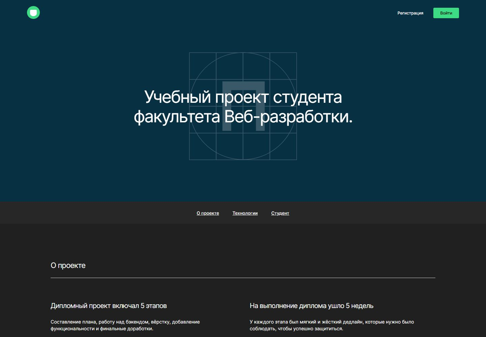

# Movies Explorer

A React app for discovering films, filtering short movies, and managing a personal saved-movies list.

## Live Demo

[Open Movies Explorer](https://goldlexx.github.io/movies-explorer-frontend/)

The interface and screenshot use Russian-language content.

## Features

- Search the movie catalogue and filter short films
- Register, sign in, and edit a profile
- Save movies to a personal list and remove them later
- Browse eight bundled local demo movies immediately; no external catalogue request is required

## Tech Stack

- React 18 and React Router 6
- Create React App (`react-scripts` 5)
- JavaScript and CSS
- Cloudflare Workers API for account and saved-movie data

## Getting Started

```bash
git clone https://github.com/goldlexx/movies-explorer-frontend.git
cd movies-explorer-frontend
npm ci
npm start
```

Create a production build with `npm run build`.

## API Configuration

The frontend provides defaults for the saved-movies API and movie image host. Override them at build time with:

- `REACT_APP_MOVIES_API_BASE_URL`
- `REACT_APP_MOVIE_ASSETS_BASE_URL`

The saved-movies API defaults to `https://movies-explorer-api.rustik-yuldashev.workers.dev`. The catalogue uses bundled demo data and the demo posters are bundled locally. Do not place private credentials in frontend environment variables; values included in a browser build are public.

## Project Background

This movie-search application was created as a learning project during the Yandex Practicum web development course.

## Screenshot



The screenshot shows the local interface; its text is in Russian.
