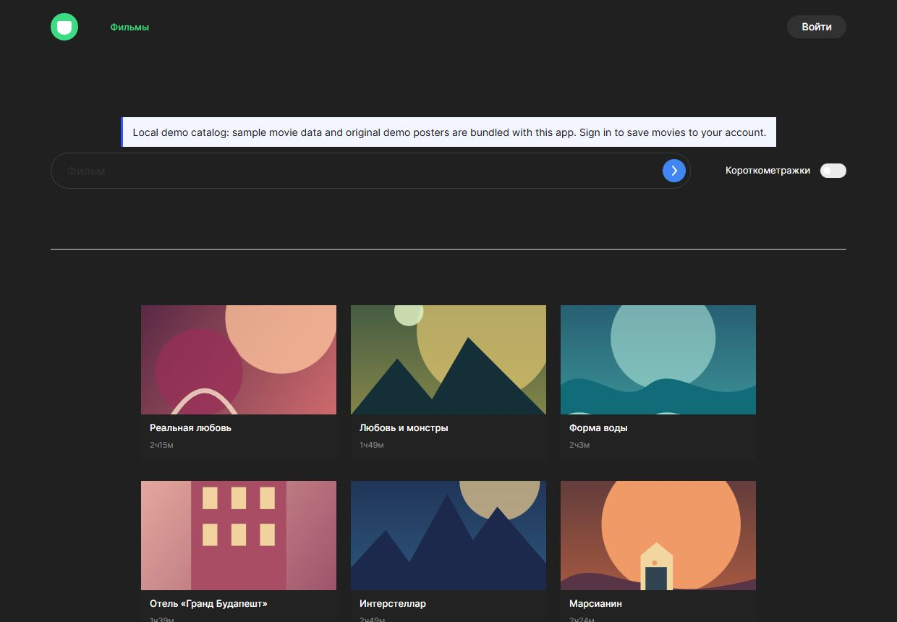
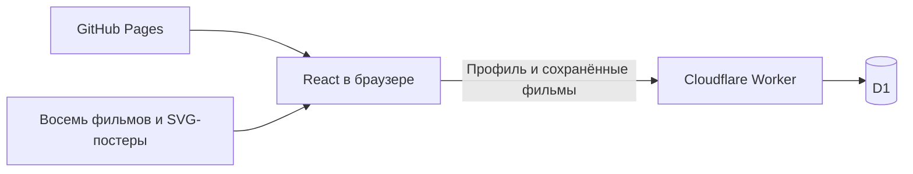

<div align="center">

# 🎬 Movies Explorer

**Кинокаталог с поиском на двух языках, фильтром короткометражек и личной коллекцией.**

  

[Открыть приложение](https://goldlexx.github.io/movies-explorer-frontend/) · [Репозиторий API](https://github.com/goldlexx/movies-explorer-api) · [Запуск](#локальный-запуск)

</div>


## Попробуйте в каталоге

1. Откройте [каталог фильмов](https://goldlexx.github.io/movies-explorer-frontend/movies). Восемь демонстрационных фильмов доступны для просмотра и поиска без входа.
2. Введите `love`. Поиск учитывает русские и английские названия, поэтому в подборке можно найти «Реальную любовь» и «Любовь и монстры». Фильтр короткометражек оставляет фильмы длительностью до 40 минут включительно.
3. Зарегистрируйтесь или войдите, затем сохраните фильм и откройте раздел сохранённых. Там можно снова воспользоваться поиском и удалить фильм из своей коллекции. У карточек есть переход к поиску трейлера на YouTube.
4. В профиле можно изменить имя и email. Коллекция привязана к учётной записи.



## Каталог и учётная запись



[Каталог из восьми демонстрационных фильмов](src/data/demoMovies.js) включён в сборку вместе с постерами. Список открывается без запроса к внешнему киносправочнику. Данные пользователя и сохранённые фильмы поступают из отдельного [REST API](https://github.com/goldlexx/movies-explorer-api). Для регистрации, входа и изменения коллекции требуется доступ к нему.

| Технология | Что делает в проекте |
| --- | --- |
| React 18 и React Router | Публичная страница, маршруты авторизации, каталог, коллекция и профиль |
| JavaScript и CSS | Поиск, фильтр и число карточек с учётом ширины экрана |
| Create React App | Сборка клиента и тесты интерфейса |
| Workers и D1 | Серверная часть, которая хранит учётные записи и коллекции |

## Локальный запуск

```sh
npm ci
npm start
```

[Конфигурация API](src/utils/config.js) использует `REACT_APP_MOVIES_API_BASE_URL` для пользовательских данных и `REACT_APP_MOVIE_ASSETS_BASE_URL` для относительных ссылок на изображения. Собственные значения задаются в `.env.local` до старта или сборки. Они попадут в браузерный код.

По умолчанию выбран опубликованный Worker. Его CORS разрешает origin GitHub Pages. Для локальной проверки авторизации нужен API, разрешающий origin вашего браузера. Опубликованное приложение уже работает с согласованной парой адресов.

## Сборка и тесты

`npm run build` создаёт каталог `build/`. Команда `npm test -- --watchAll=false` запускает тесты приложения, формы поиска, обработки HTTP-ответов и клиента сохранённых фильмов.
